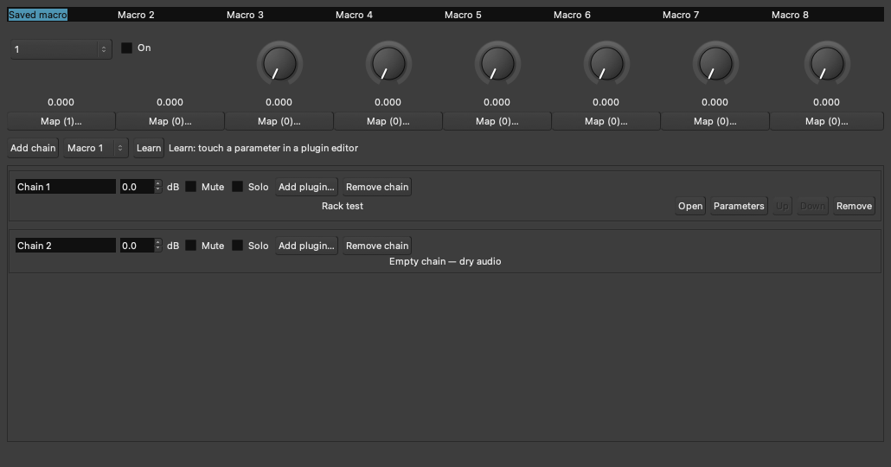
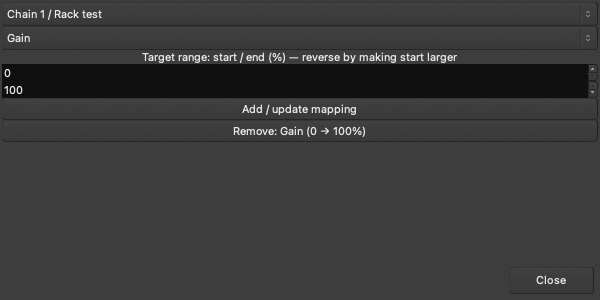
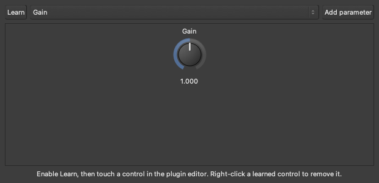
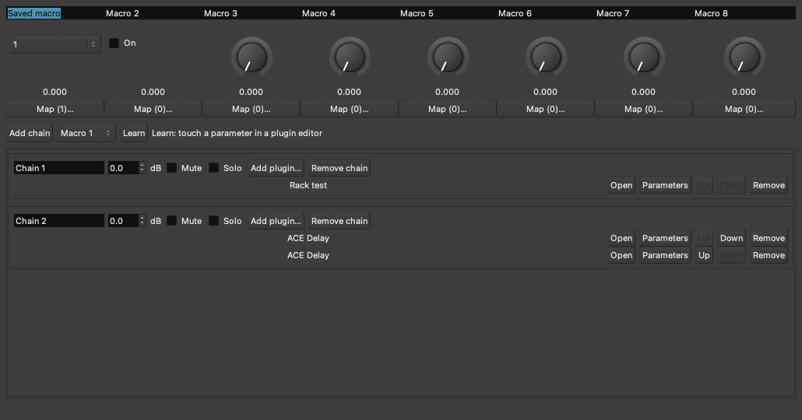

# Audio racks and learned plugin controls

## Intended behavior

- Insert an Audio Rack from the processor list and open it like a plugin.
- Eight renameable macros support knob, toggle and choice-dropdown presentations and each map to one or more parameters, with independently adjustable minimum/maximum ranges (including reversed ranges).
- Add parallel chains with names, gain, mute and solo. Plugins in a chain run in series. Empty chains pass dry audio. Chain outputs sum without automatic normalization.
- Add, remove and reorder plugins inside each chain; open native or generic editors.
- Arm Learn, then touch a plugin parameter to map it. Explicit parameter selection remains available for plugins that do not report touches. Right-click a macro or learned control for removal.
- Use native parameter descriptors for continuous knobs, toggles, integer controls and enumerated dropdowns.
- Save chains, plugin states, macros, mappings and learned parameter panels in session XML.

## Existing architecture

Routes own an ordered list of Processor instances. PluginInsert owns plugin instances, parameter controls, automation and channel mapping. ProcessorBox creates processors and their windows, while GenericPluginUI builds controls from parameter descriptors. There is no processor container for parallel plugin chains or a user-curated parameter panel.

## Proposed architecture

- Engine: AudioRack is a Processor with parallel chains containing existing PluginInsert instances; no new plugin format or dependency.
- Buffer ownership: allocate chain scratch buffers and latency delay lines during configuration, never in run(). Keep MIDI on the rack's original path, once; this is an audio-effect rack and rejects instruments, MIDI-processing plugins and external sidechains.
- Edits: retire anticipation and hold the engine process lock for topology/configuration changes; reject edits while recording. Racks explicitly opt their owning routes out of anticipative processing until nested plugin controls participate in that scheduler.
- Latency: report the longest chain; align shorter chains with FixedDelay, updating allocations in the route's non-realtime latency update.
- Macros: normalized AutomationControl values and mappings to child parameter IDs; descriptor conversions preserve logarithmic/integer/toggle/enum semantics. A parameter belongs to at most one macro. Existing child automation remains authoritative when in playback mode.
- UI: rack editor with macro bank, chain rows, plugin rows, explicit mapping chooser and touch learning. Reuse PluginSelector, PluginUIWindow and AutomationController.
- Learned panels: plugin extra XML stores a curated list of parameter IDs. Learn uses control-touch notifications and native parameter notifications; no subscription to automation value changes.

## Files needed

- `libs/ardour/ardour/audio_rack.h`, `libs/ardour/audio_rack.cc`: container processing, editing and XML state.
- `libs/ardour/route.cc`: load racks and refresh their internal latency compensation.
- `libs/ardour/anticipative_process.cc`: keep rack routes on the realtime path.
- `libs/ardour/wscript`: compile the model.
- `gtk2_ardour/audio_rack_ui.h`, `gtk2_ardour/audio_rack_ui.cc`: rack and learned-control editors.
- `gtk2_ardour/processor_box.cc`: create/open racks.
- `gtk2_ardour/plugin_ui.h`, `gtk2_ardour/plugin_ui.cc`, `gtk2_ardour/generic_pluginui.cc`: learned-panel entry points.
- `gtk2_ardour/route_properties_box.cc`: rack access from the compact device area.
- `gtk2_ardour/wscript`: compile the UI.
- `libs/ardour/test/` and/or `tools/dev/`: engine and state round-trip verification.

## Minimal scope and risks

Nested racks, chain-selector zones, drag-and-drop between racks, rack preset libraries and dedicated macro automation lanes are follow-ups. Chain gain/mute/solo and parameter maps are session state; normal plugin automation is retained. Missing or incompatible plugins must preserve the entire rack XML via UnknownProcessor rather than silently dropping effects. Native plugins differ in their touch notifications, so the explicit mapping chooser is essential. Topology edits are not undoable in the existing processor workflow; removal must be explicit.

## Acceptance checks

1. Process an impulse through two chains with unequal latency and known gain; verify alignment, summed amplitude, mute/solo, bypass and no MIDI duplication.
2. Map continuous, toggle and enum parameters, test reversed ranges and multiple targets, remove a mapping, and reload XML with the same IDs and values. Exercise invalid state and plugin removal.
3. Build the native engine and GUI. Open a rack, add plugins/chains, learn a parameter and remove it through its context menu; retain screenshots when a disposable GUI environment is available.

Complexity: 4/5. Risk: 4/5 (realtime processing, plugin lifecycle and persistence). Verification target: engine integration tests plus native GUI inspection; source-only checks are insufficient.

## Implementation status — 2026-11-18

Implemented on `jay/audio-racks`, based on `bdded27`, in the isolated
`ardour-audio-racks` worktree. No merge or installation into the regular app.

- Native macOS arm64 engine and GUI build passed, including all support libraries.
- Four native C++ integration cases passed: chain mixing and persistence, mapping
  semantics, sample-exact parallel delay compensation (including a block boundary),
  and complete session reopening. Checks also cover copy IDs, macro presentation,
  MIDI preservation, bypass, mute/solo, invalid inputs and mapping cleanup.
- Native GTK interaction checks passed for opening a restored rack, adding a chain,
  opening mappings and plugin parameters, adding a learned control, removing it
  through its right-click menu, learning it again from a slider gesture, and changing
  macro presentations to choices and toggle.
- Saving from the native GUI preserved two chains, the selected macro presentations
  and the learned parameter ID. The GUI ran with isolated preferences, dummy audio,
  a separate MCP port and process-local semaphore names.
- Evidence is in `audio-rack-evidence/`. The offscreen GTK screenshot technique
  produces Quartz window-type diagnostics; the rendered images were inspected.
  Earlier build-cache and test-harness setup failures were corrected before the
  final passing checks.

### Review notes and boundaries

- Added `anticipative_process.cc` to the implementation scope after inspection
  showed that unrecognized processors are not automatically excluded from workers.
- Macro values use atomic handoff to DSP. Structural edits retire anticipation and
  hold the process lock; scratch buffers and delay lines are prepared outside DSP.
- Plugin selectors retain the chosen chain's identity, so removing a chain while
  the selector is open cannot insert plugins into a different chain.
- Learned controls live in a separate native window reached from the plugin toolbar
  or compact panel. The existing full generic/native plugin editors remain available.
- Audio effects only, unchanged channel layout, no external sidechain ports. No
  nested racks, chain-selector zones, rack presets, structural undo or dedicated
  macro automation lanes in this implementation. Third-party plugin-specific native
  touch notifications were not exhaustively tested; the explicit chooser provides
  an independent mapping path.

### Visual evidence

## Plugin insertion correction — 2026-11-18

The initial rack UI displayed PluginSelector without entering its response loop,
so Insert Plugin(s) did not invoke the rack's insertion callback. Add plugin now
uses the same `show_manager()` entry point as the route processor list and parents
the chooser to the rack window.

The extended native GUI regression reproduced the original failure with ACE Delay
(zero inserted plugins and the chooser left open). With the fix, mouse insertion
and keyboard insertion each add one ACE Delay to the second chain; reopening
clears the previous queue, and Cancel leaves the chain unchanged. Saving the
session confirms the original plugin stays in chain one and both effects are in
chain two. The complete native build and prior GUI checks also passed.

